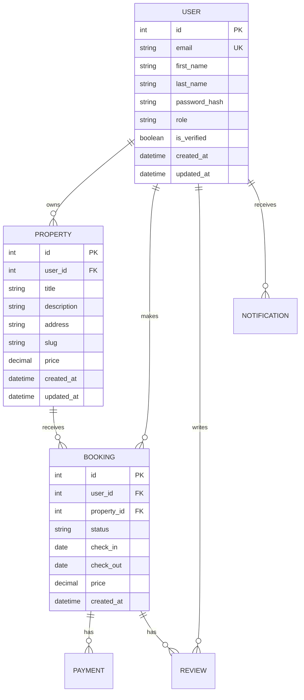
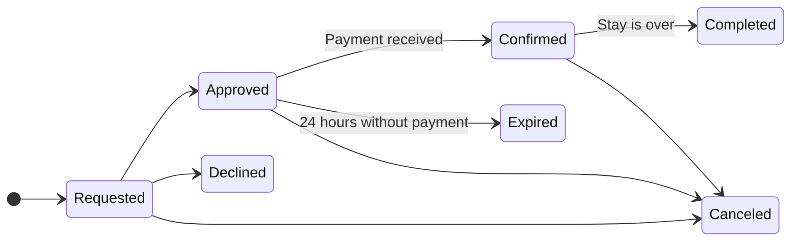

## Entity-relationship diagram

## State diagram

### Notes/Constraints
1. Statuses that block the dates, so nobody else can book them.
    - Approved
    - Requested
    - Confirmed
    - Completed
2. There can oly be one review per booking
3. Why the booking stores the total price instead of working it out from the property's price each time is because: The landlord may change the price later, but the guest agreed to the old one.